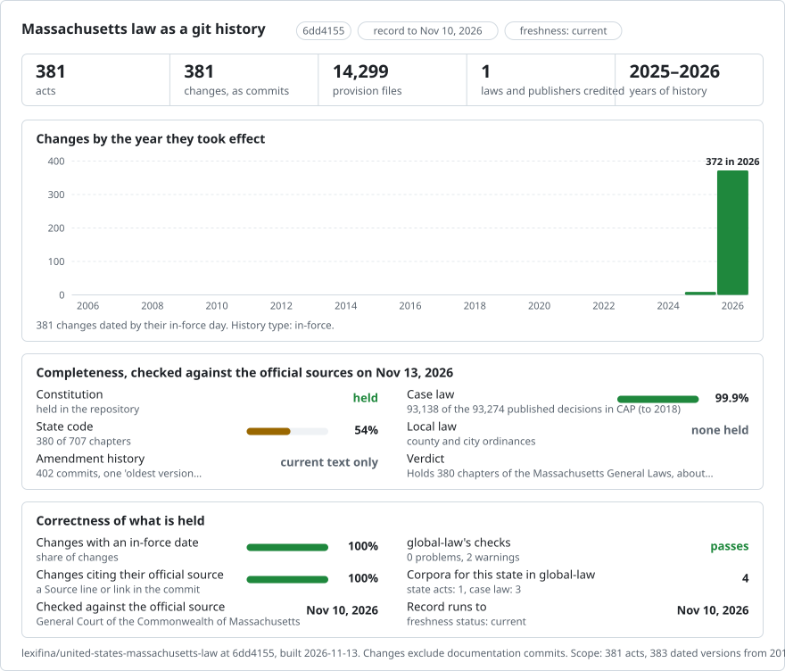

# Massachusetts: law history in git

<picture>
<source media="(prefers-color-scheme: dark)" srcset="data/effort-dark.svg">

</picture>

Part of [lexifina/global-law](https://github.com/lexifina/global-law), one git history for every country's law: this is the law of Massachusetts, United States, which global-law reads at `united-states/massachusetts/acts/`.

The Constitution of the Commonwealth of Massachusetts and chapters of the General Laws as a git repository: one file per article, section or article of amendment of the Constitution and one per section of the General Laws, committed with the General Court as its publisher. It follows the shared design of [lexifina/global-law](https://github.com/lexifina/global-law), which places it at `united-states/massachusetts/`.

**What is in it now**

| Folder | Act | Units | History |
| --- | --- | ---: | --- |
| `constitution/` | Constitution of the Commonwealth of Massachusetts (1780, as amended): Preamble, Part the First, Part the Second, the Articles of Amendment, and the notes on amendments rejected | 229 | One version: the General Court's online text as captured on 15 October 2026 |
| `gl-chapter-0015c/` | General Laws, Chapter 15C: MASSACHUSETTS COLLEGE STUDENT LOAN AUTHORITY | 36 | One current-text version: official General Court text retrieved 2026-11-13; the source supplies no current-text amendment date |
| `gl-chapter-0073/` | General Laws, Chapter 73: STATE COLLEGES AND COMMUNITY COLLEGES | 32 | One current-text version: official General Court text retrieved 2026-11-13; the source supplies no current-text amendment date |
| `gl-chapter-0083/` | General Laws, Chapter 83: SEWERS, DRAINS AND SIDEWALKS | 49 | One current-text version: official General Court text retrieved 2026-11-13; the source supplies no current-text amendment date |
| `gl-chapter-0093e/` | General Laws, Chapter 93E: REGULATION OF DEALERS' AGREEMENTS FOR THE SALE OF GASOLINE | 15 | One current-text version: official General Court text retrieved 2026-11-13; the source supplies no current-text amendment date |
| `gl-chapter-0092b/` | General Laws, Chapter 92B: COMMONWEALTH ZOOLOGICAL CORPORATION | 12 | One current-text version: official General Court text retrieved 2026-11-13; the source supplies no current-text amendment date |
| `gl-chapter-0088/` | General Laws, Chapter 88: FERRIES, CANALS AND PUBLIC LANDINGS | 19 | One current-text version: official General Court text retrieved 2026-11-13; the source supplies no current-text amendment date |
| `gl-chapter-0063b/` | General Laws, Chapter 63B: DECLARATION OF ESTIMATED TAX BY CORPORATIONS | 13 | One current-text version: official General Court text retrieved 2026-11-13; the source supplies no current-text amendment date |
| `gl-chapter-0043d/` | General Laws, Chapter 43D: EXPEDITED PERMITTING | 17 | One current-text version: official General Court text retrieved 2026-11-13; the source supplies no current-text amendment date |
| `gl-chapter-0042/` | General Laws, Chapter 42: BOUNDARIES OF CITIES AND TOWNS | 12 | One current-text version: official General Court text retrieved 2026-11-13; the source supplies no current-text amendment date |
| `gl-chapter-0040m/` | General Laws, Chapter 40M: GOVERNMENTAL UNITS POOLED INSURANCE | 17 | One current-text version: official General Court text retrieved 2026-11-13; the source supplies no current-text amendment date |
| `gl-chapter-0040g/` | General Laws, Chapter 40G: MASSACHUSETTS TECHNOLOGY DEVELOPMENT CORPORATION | 16 | One current-text version: official General Court text retrieved 2026-11-13; the source supplies no current-text amendment date |
| `gl-chapter-0040d/` | General Laws, Chapter 40D: INDUSTRIAL DEVELOPMENT OF CITIES AND TOWNS | 23 | One current-text version: official General Court text retrieved 2026-11-13; the source supplies no current-text amendment date |
| `gl-chapter-0037/` | General Laws, Chapter 37: SHERIFFS | 24 | One current-text version: official General Court text retrieved 2026-11-13; the source supplies no current-text amendment date |
| `gl-chapter-0034a/` | General Laws, Chapter 34A: COUNTY CHARTER PROCEDURES | 21 | One current-text version: official General Court text retrieved 2026-11-13; the source supplies no current-text amendment date |
| `gl-chapter-0023e/` | General Laws, Chapter 23E: DIVISION OF INDUSTRIAL ACCIDENTS | 15 | One current-text version: official General Court text retrieved 2026-11-13; the source supplies no current-text amendment date |
| `gl-chapter-0021b/` | General Laws, Chapter 21B: MINING REGULATION AND RECLAMATION | 15 | One current-text version: official General Court text retrieved 2026-11-13; the source supplies no current-text amendment date |
| `gl-chapter-0018c/` | General Laws, Chapter 18C: OFFICE OF THE CHILD ADVOCATE | 15 | One current-text version: official General Court text retrieved 2026-11-13; the source supplies no current-text amendment date |
| `gl-chapter-0017/` | General Laws, Chapter 17: DEPARTMENT OF PUBLIC HEALTH | 28 | One current-text version: official General Court text retrieved 2026-11-13; the source supplies no current-text amendment date |
| `gl-chapter-0016/` | General Laws, Chapter 16: DEPARTMENT OF HIGHWAYS | 15 | One current-text version: official General Court text retrieved 2026-11-13; the source supplies no current-text amendment date |
| `gl-chapter-0008/` | General Laws, Chapter 8: STATE SUPERINTENDENT OF BUILDINGS, AND STATE HOUSE | 28 | One current-text version: official General Court text retrieved 2026-11-13; the source supplies no current-text amendment date |
| `gl-chapter-0001/` | General Laws, Chapter 1: Jurisdiction of the commonwealth and of the united states | 11 | One version: the General Court's online text, each section from its newest web capture (captured 2025-03-26 to 2026-06-04), dated 2026-06-04 |
| `gl-chapter-0002/` | General Laws, Chapter 2: Arms, great seal and other emblems of the commonwealth | 66 | One version: the General Court's online text, each section from its newest web capture (captured 2025-07-09 to 2026-10-10), dated 2026-10-10 |
| `gl-chapter-0004/` | General Laws, Chapter 4: Statutes | 20 | One version: the General Court's online text, each section from its newest web capture (captured 2025-04-01 to 2026-10-26), dated 2026-10-26 |
| `gl-chapter-0006c/` | General Laws, Chapter 6C: Massachusetts department of transportation | 82 | One version: the General Court's online text, each section from its newest web capture (captured 2023-04-29 to 2026-10-18), dated 2026-10-18 |
| `gl-chapter-0006d/` | General Laws, Chapter 6D: Health policy commission | 26 | One version: the General Court's online text, each section from its newest web capture (captured 2026-01-14 to 2026-10-18), dated 2026-10-18 |
| `gl-chapter-0006e/` | General Laws, Chapter 6E: Massachusetts peace officer standards and training commission | 14 | One version: the General Court's online text, each section from its newest web capture (captured 2023-05-10 to 2026-10-17), dated 2026-10-17 |
| `gl-chapter-0007/` | General Laws, Chapter 7: Executive office for administration and finance | 106 | One version: the General Court's online text, each section from its newest web capture (captured 2025-07-17 to 2026-10-15), dated 2026-10-15 |
| `gl-chapter-0007a/` | General Laws, Chapter 7A: Office of the comptroller | 21 | One version: the General Court's online text, each section from its newest web capture (captured 2026-02-12 to 2026-10-11), dated 2026-10-11 |
| `gl-chapter-0007b/` | General Laws, Chapter 7B: Asset management board | 9 | One version: the General Court's online text, each section from its newest web capture (captured 2025-03-26 to 2025-04-02), dated 2026-06-09 |
| `gl-chapter-0007c/` | General Laws, Chapter 7C: Capital asset management and maintenance | 74 | One version: the General Court's online text, each section from its newest web capture (captured 2026-01-24 to 2026-10-16), dated 2026-10-16 |
| `gl-chapter-0007d/` | General Laws, Chapter 7D: Massachusetts office of information technology | 14 | One version: the General Court's online text, each section from its newest web capture (captured 2026-03-06 to 2026-10-08), dated 2026-10-08 |
| `gl-chapter-0009a/` | General Laws, Chapter 9A: Address confidentiality program | 7 | One version: the General Court's online text, each section from its newest web capture (captured 2023-06-07 to 2026-07-06), dated 2026-09-13 |
| `gl-chapter-0011/` | General Laws, Chapter 11: Department of the state auditor | 10 | One version: the General Court's online text, each section from its newest web capture (captured 2026-04-14 to 2026-09-13), dated 2026-09-13 |
| `gl-chapter-0012/` | General Laws, Chapter 12: Department of the attorney general, and the district attorneys | 89 | One version: the General Court's online text, each section from its newest web capture (captured 2025-03-24 to 2026-10-26), dated 2026-10-26 |
| `gl-chapter-0012a/` | General Laws, Chapter 12A: Office of inspector general | 15 | One version: the General Court's online text, each section from its newest web capture (captured 2024-12-10 to 2026-08-17), dated 2026-10-09 |
| `gl-chapter-0012c/` | General Laws, Chapter 12C: Center for health information and analysis | 28 | One version: the General Court's online text, each section from its newest web capture (captured 2026-04-11 to 2026-10-13), dated 2026-10-13 |
| `gl-chapter-0015/` | General Laws, Chapter 15: Department of elementary and secondary education | 37 | One version: the General Court's online text, each section from its newest web capture (captured 2024-04-15 to 2026-10-07), dated 2026-10-07 |
| `gl-chapter-0015d/` | General Laws, Chapter 15D: Department of early education and care | 29 | One version: the General Court's online text, each section from its newest web capture (captured 2026-05-10 to 2026-08-12), dated 2026-10-16 |
| `gl-chapter-0015e/` | General Laws, Chapter 15E: Interstate compact on educational opportunity for military children | 19 | One version: the General Court's online text, each section from its newest web capture (captured 2025-09-03 to 2025-12-24), dated 2026-06-16 |
| `gl-chapter-0018a/` | General Laws, Chapter 18A: Department of youth services | 10 | One version: the General Court's online text, each section from its newest web capture (captured 2025-12-05 to 2025-12-16), dated 2026-01-13 |
| `gl-chapter-0019/` | General Laws, Chapter 19: Department of mental health | 29 | One version: the General Court's online text, each section from its newest web capture (captured 2026-05-21 to 2026-10-05), dated 2026-10-05 |
| `gl-chapter-0019b/` | General Laws, Chapter 19B: Department of developmental services | 22 | One version: the General Court's online text, each section from its newest web capture (captured 2025-05-12 to 2026-09-12), dated 2026-09-12 |
| `gl-chapter-0019c/` | General Laws, Chapter 19C: Disabled persons protection commission | 15 | One version: the General Court's online text, each section from its newest web capture (captured 2025-07-14 to 2026-10-12), dated 2026-10-12 |
| `gl-chapter-0019d/` | General Laws, Chapter 19D: Assisted living | 19 | One version: the General Court's online text, each section from its newest web capture (captured 2026-02-15 to 2026-10-14), dated 2026-10-14 |
| `gl-chapter-0021a/` | General Laws, Chapter 21A: Executive office of energy and environmental affairs | 68 | One version: the General Court's online text, each section from its newest web capture (captured 2026-03-13 to 2026-09-15), dated 2026-09-15 |
| `gl-chapter-0021c/` | General Laws, Chapter 21C: Massachusetts hazardous waste management act | 28 | One version: the General Court's online text, each section from its newest web capture (captured 2026-06-08 to 2026-09-05), dated 2026-09-05 |
| `gl-chapter-0021d/` | General Laws, Chapter 21D: Massachusetts hazardous waste facility siting act | 19 | One version: the General Court's online text, each section from its newest web capture (captured 2023-05-11 to 2026-05-05), dated 2026-05-05 |
| `gl-chapter-0021e/` | General Laws, Chapter 21E: Massachusetts oil and hazardous material release prevention and response act | 30 | One version: the General Court's online text, each section from its newest web capture (captured 2017-07-10 to 2026-10-14), dated 2026-10-14 |
| `gl-chapter-0021g/` | General Laws, Chapter 21G: Massachusetts water management act | 20 | One version: the General Court's online text, each section from its newest web capture (captured 2026-01-16 to 2026-10-18), dated 2026-10-18 |
| `gl-chapter-0021h/` | General Laws, Chapter 21H: Solid waste facilities | 21 | One version: the General Court's online text, each section from its newest web capture (captured 2025-08-03 to 2026-09-12), dated 2026-09-12 |
| `gl-chapter-0021i/` | General Laws, Chapter 21I: Massachusetts toxics use reduction act | 24 | One version: the General Court's online text, each section from its newest web capture (captured 2026-03-11 to 2026-10-12), dated 2026-10-12 |
| `gl-chapter-0021j/` | General Laws, Chapter 21J: Underground storage tank petroleum product cleanup fund | 14 | One version: the General Court's online text, each section from its newest web capture (captured 2026-01-14 to 2026-05-19), dated 2026-05-19 |
| `gl-chapter-0021m/` | General Laws, Chapter 21M: Vessel traffic service | 9 | One version: the General Court's online text, each section from its newest web capture (captured 2023-05-13 to 2026-10-31), dated 2026-10-31 |
| `gl-chapter-0021n/` | General Laws, Chapter 21N: Climate protection and green economy act | 14 | One version: the General Court's online text, each section from its newest web capture (captured 2026-01-15 to 2026-09-17), dated 2026-09-17 |
| `gl-chapter-0021o/` | General Laws, Chapter 21O: Operation and removal of underground storage tanks | 9 | One version: the General Court's online text, each section from its newest web capture (captured 2025-03-31 to 2026-01-18), dated 2026-10-15 |
| `gl-chapter-0022/` | General Laws, Chapter 22: Division of professional licensure office of public safety and inspections | 27 | One version: the General Court's online text, each section from its newest web capture (captured 2024-11-06 to 2026-09-15), dated 2026-09-15 |
| `gl-chapter-0022c/` | General Laws, Chapter 22C: The department of state police | 80 | One version: the General Court's online text, each section from its newest web capture (captured 2026-06-08 to 2026-10-12), dated 2026-10-12 |
| `gl-chapter-0022d/` | General Laws, Chapter 22D: Department of fire services | 6 | One version: the General Court's online text, each section from its newest web capture (captured 2025-02-05 to 2025-11-16), dated 2025-11-16 |
| `gl-chapter-0022e/` | General Laws, Chapter 22E: State dna database | 15 | One version: the General Court's online text, each section from its newest web capture (captured 2026-05-18 to 2026-10-14), dated 2026-10-14 |
| `gl-chapter-0023a/` | General Laws, Chapter 23A: Department of economic development | 74 | One version: the General Court's online text, each section from its newest web capture (captured 2026-01-14 to 2026-10-18), dated 2026-10-18 |
| `gl-chapter-0023b/` | General Laws, Chapter 23B: Executive office of housing and livable communities | 25 | One version: the General Court's online text, each section from its newest web capture (captured 2026-07-13 to 2026-10-05), dated 2026-10-05 |
| `gl-chapter-0023g/` | General Laws, Chapter 23G: The massachusetts development finance agency | 54 | One version: the General Court's online text, each section from its newest web capture (captured 2025-12-11 to 2026-10-16), dated 2026-10-16 |
| `gl-chapter-0023k/` | General Laws, Chapter 23K: THE MASSACHUSETTS GAMING COMMISSION fee or tax; penalties. | 71 | One version: the General Court's online text, each section from its newest web capture (captured 2026-01-18 to 2026-10-09), dated 2026-10-09 |
| `gl-chapter-0025/` | General Laws, Chapter 25: Department of public utilities | 43 | One version: the General Court's online text, each section from its newest web capture (captured 2026-04-15 to 2026-10-14), dated 2026-10-14 |
| `gl-chapter-0025a/` | General Laws, Chapter 25A: Division of energy resources | 31 | One version: the General Court's online text, each section from its newest web capture (captured 2026-02-12 to 2026-10-17), dated 2026-10-17 |
| `gl-chapter-0027/` | General Laws, Chapter 27: Department of correction | 8 | One version: the General Court's online text, each section from its newest web capture (captured 2021-04-11 to 2026-07-15), dated 2026-07-15 |
| `gl-chapter-0029/` | General Laws, Chapter 29: State finance | 283 | One version: the General Court's online text, each section from its newest web capture (captured 2026-02-07 to 2026-10-17), dated 2026-10-17 |
| `gl-chapter-0029c/` | General Laws, Chapter 29C: Massachusetts clean water trust | 21 | One version: the General Court's online text, each section from its newest web capture (captured 2025-03-19 to 2026-10-05), dated 2026-10-05 |
| `gl-chapter-0030/` | General Laws, Chapter 30: General provisions relative to state departments, commissions, officers and employees | 132 | One version: the General Court's online text, each section from its newest web capture (captured 2025-02-02 to 2026-10-12), dated 2026-10-12 |
| `gl-chapter-0030a/` | General Laws, Chapter 30A: State administrative procedure | 41 | One version: the General Court's online text, each section from its newest web capture (captured 2026-03-14 to 2026-10-17), dated 2026-10-18 |
| `gl-chapter-0030b/` | General Laws, Chapter 30B: Uniform procurement act | 25 | One version: the General Court's online text, each section from its newest web capture (captured 2026-05-10 to 2026-10-17), dated 2026-10-17 |
| `gl-chapter-0032b/` | General Laws, Chapter 32B: Contributory group general or blanket insurance for persons in the service of counties, cities, towns and districts, and their dependents | 52 | One version: the General Court's online text, each section from its newest web capture (captured 2025-02-24 to 2026-10-11), dated 2026-10-17 |
| `gl-chapter-0033/` | General Laws, Chapter 33: Militia | 135 | One version: the General Court's online text, each section from its newest web capture (captured 2026-05-17 to 2026-09-15), dated 2026-09-15 |
| `gl-chapter-0033a/` | General Laws, Chapter 33A: Massachusetts code of military justice | 136 | One version: the General Court's online text, each section from its newest web capture (captured 2026-06-06 to 2026-06-13), dated 2026-06-13 |
| `gl-chapter-0034b/` | General Laws, Chapter 34B: Abolition of county government | 23 | One version: the General Court's online text, each section from its newest web capture (captured 2023-05-04 to 2026-09-05), dated 2026-09-05 |
| `gl-chapter-0038/` | General Laws, Chapter 38: Medical examiners and inquests | 19 | One version: the General Court's online text, each section from its newest web capture (captured 2025-03-11 to 2026-08-31), dated 2026-08-31 |
| `gl-chapter-0039/` | General Laws, Chapter 39: Municipal government | 27 | One version: the General Court's online text, each section from its newest web capture (captured 2025-04-02 to 2026-08-15), dated 2026-08-15 |
| `gl-chapter-0040a/` | General Laws, Chapter 40A: Zoning | 24 | One version: the General Court's online text, each section from its newest web capture (captured 2026-03-08 to 2026-10-11), dated 2026-10-11 |
| `gl-chapter-0040c/` | General Laws, Chapter 40C: Historic districts | 18 | One version: the General Court's online text, each section from its newest web capture (captured 2025-03-19 to 2026-10-07), dated 2026-10-07 |
| `gl-chapter-0040h/` | General Laws, Chapter 40H: Community economic development assistance corporation | 10 | One version: the General Court's online text, each section from its newest web capture (captured 2023-10-03 to 2026-08-09), dated 2026-08-09 |
| `gl-chapter-0040n/` | General Laws, Chapter 40N: Model water and sewer commission | 27 | One version: the General Court's online text, each section from its newest web capture (captured 2021-05-08 to 2026-10-09), dated 2026-10-09 |
| `gl-chapter-0040p/` | General Laws, Chapter 40P: The massachusetts rent control prohibition act | 5 | One version: the General Court's online text, each section from its newest web capture (captured 2026-05-08 to 2026-10-15), dated 2026-10-15 |
| `gl-chapter-0040q/` | General Laws, Chapter 40Q: District improvement financing | 4 | One version: the General Court's online text, each section from its newest web capture (captured 2025-04-03 to 2026-01-14), dated 2026-02-09 |
| `gl-chapter-0040r/` | General Laws, Chapter 40R: Smart growth zoning and housing production | 14 | One version: the General Court's online text, each section from its newest web capture (captured 2026-07-11 to 2026-10-11), dated 2026-10-11 |
| `gl-chapter-0040s/` | General Laws, Chapter 40S: Smart growth school cost reimbursement | 4 | One version: the General Court's online text, each section from its newest web capture (captured 2023-05-11 to 2023-05-11), dated 2026-05-18 |
| `gl-chapter-0040t/` | General Laws, Chapter 40T: PUBLICLY&ndash;ASSISTED AFFORDABLE HOUSING | 10 | One version: the General Court's online text, each section from its newest web capture (captured 2023-05-11 to 2026-07-20), dated 2026-07-20 |
| `gl-chapter-0040u/` | General Laws, Chapter 40U: Municipal fines | 18 | One version: the General Court's online text, each section from its newest web capture (captured 2026-04-11 to 2026-04-21), dated 2026-05-20 |
| `gl-chapter-0040v/` | General Laws, Chapter 40V: Housing development incentive program | 5 | One version: the General Court's online text, each section from its newest web capture (captured 2026-07-17 to 2026-08-17), dated 2026-08-17 |
| `gl-chapter-0043c/` | General Laws, Chapter 43C: Optional forms of municipal administration act | 15 | One version: the General Court's online text, each section from its newest web capture (captured 2026-07-20 to 2026-09-14), dated 2026-09-14 |
| `gl-chapter-0044/` | General Laws, Chapter 44: Municipal finance | 117 | One version: the General Court's online text, each section from its newest web capture (captured 2026-04-15 to 2026-10-15), dated 2026-10-15 |
| `gl-chapter-0044a/` | General Laws, Chapter 44A: Qualified bond act | 13 | One version: the General Court's online text, each section from its newest web capture (captured 2025-12-05 to 2026-10-15), dated 2026-10-15 |
| `gl-chapter-0044b/` | General Laws, Chapter 44B: Community preservation | 17 | One version: the General Court's online text, each section from its newest web capture (captured 2026-03-08 to 2026-09-11), dated 2026-10-17 |
| `gl-chapter-0045/` | General Laws, Chapter 45: Public parks, playgrounds and the public domain | 31 | One version: the General Court's online text, each section from its newest web capture (captured 2024-11-11 to 2026-09-13), dated 2026-10-12 |
| `gl-chapter-0046/` | General Laws, Chapter 46: Return and registry of births, marriages and deaths | 59 | One version: the General Court's online text, each section from its newest web capture (captured 2025-11-26 to 2026-10-12), dated 2026-10-12 |
| `gl-chapter-0049/` | General Laws, Chapter 49: Fences, fence viewers, pounds and field drivers | 42 | One version: the General Court's online text, each section from its newest web capture (captured 2026-01-23 to 2026-08-14), dated 2026-10-05 |
| `gl-chapter-0050/` | General Laws, Chapter 50: General provisions relative to primaries, caucuses and elections | 10 | One version: the General Court's online text, each section from its newest web capture (captured 2026-09-15 to 2026-10-15), dated 2026-10-17 |
| `gl-chapter-0051/` | General Laws, Chapter 51: Voters | 97 | One version: the General Court's online text, each section from its newest web capture (captured 2025-02-02 to 2026-10-13), dated 2026-10-13 |
| `gl-chapter-0052/` | General Laws, Chapter 52: Political committees | 11 | One version: the General Court's online text, each section from its newest web capture (captured 2025-11-13 to 2026-10-11), dated 2026-10-11 |
| `gl-chapter-0055/` | General Laws, Chapter 55: Disclosure and regulation of campaign expenditures and contributions | 62 | One version: the General Court's online text, each section from its newest web capture (captured 2025-10-15 to 2026-10-17), dated 2026-10-17 |
| `gl-chapter-0057/` | General Laws, Chapter 57: Congressional, councillor and senatorial districts, and apportionment of representatives | 6 | One version: the General Court's online text, each section from its newest web capture (captured 2024-03-01 to 2026-10-14), dated 2026-10-14 |
| `gl-chapter-0058a/` | General Laws, Chapter 58A: Appellate tax board | 23 | One version: the General Court's online text, each section from its newest web capture (captured 2025-09-02 to 2026-10-14), dated 2026-10-14 |
| `gl-chapter-0060/` | General Laws, Chapter 60: Collection of local taxes | 138 | One version: the General Court's online text, each section from its newest web capture (captured 2025-12-07 to 2026-10-18), dated 2026-10-18 |
| `gl-chapter-0060b/` | General Laws, Chapter 60B: Excise on boats, ships and vessels in lieu of local property tax | 6 | One version: the General Court's online text, each section from its newest web capture (captured 2025-02-12 to 2025-09-03), dated 2026-04-22 |
| `gl-chapter-0061/` | General Laws, Chapter 61: Classification and taxation of forest lands and forest products | 9 | One version: the General Court's online text, each section from its newest web capture (captured 2025-11-12 to 2026-10-14), dated 2026-10-14 |
| `gl-chapter-0061a/` | General Laws, Chapter 61A: Assessment and taxation of agricultural and horticultural land | 27 | One version: the General Court's online text, each section from its newest web capture (captured 2026-02-08 to 2026-09-09), dated 2026-10-12 |
| `gl-chapter-0061b/` | General Laws, Chapter 61B: Classification and taxation of recreational land | 19 | One version: the General Court's online text, each section from its newest web capture (captured 2026-05-09 to 2026-10-17), dated 2026-10-17 |
| `gl-chapter-0062b/` | General Laws, Chapter 62B: Withholding of taxes on wages and declaration of estimated income tax | 17 | One version: the General Court's online text, each section from its newest web capture (captured 2026-07-11 to 2026-08-13), dated 2026-08-13 |
| `gl-chapter-0062c/` | General Laws, Chapter 62C: Administrative provisions relative to state taxation | 126 | One version: the General Court's online text, each section from its newest web capture (captured 2024-11-09 to 2026-10-30), dated 2026-10-30 |
| `gl-chapter-0062d/` | General Laws, Chapter 62D: SET&ndash;OFF DEBT COLLECTION | 17 | One version: the General Court's online text, each section from its newest web capture (captured 2025-10-05 to 2026-10-10), dated 2026-10-10 |
| `gl-chapter-0062e/` | General Laws, Chapter 62E: Wage reporting system | 18 | One version: the General Court's online text, each section from its newest web capture (captured 2025-03-30 to 2026-09-12), dated 2026-09-12 |
| `gl-chapter-0062f/` | General Laws, Chapter 62F: Limitation on the growth of state tax revenues | 9 | One version: the General Court's online text, each section from its newest web capture (captured 2025-06-22 to 2026-08-18), dated 2026-08-18 |
| `gl-chapter-0064a/` | General Laws, Chapter 64A: Taxation of sales of gasoline | 15 | One version: the General Court's online text, each section from its newest web capture (captured 2025-03-26 to 2026-10-31), dated 2026-10-31 |
| `gl-chapter-0064c/` | General Laws, Chapter 64C: Cigarette excise | 48 | One version: the General Court's online text, each section from its newest web capture (captured 2025-02-24 to 2026-10-15), dated 2026-10-15 |
| `gl-chapter-0064d/` | General Laws, Chapter 64D: Excise on deeds, instruments and writings | 18 | One version: the General Court's online text, each section from its newest web capture (captured 2025-03-24 to 2026-10-11), dated 2026-10-11 |
| `gl-chapter-0064e/` | General Laws, Chapter 64E: Taxation of special fuels used in the propulsion of motor vehicles | 13 | One version: the General Court's online text, each section from its newest web capture (captured 2025-03-30 to 2025-07-14), dated 2025-09-07 |
| `gl-chapter-0064f/` | General Laws, Chapter 64F: Taxation of fuel and special fuels acquired outside and used within the commonwealth | 14 | One version: the General Court's online text, each section from its newest web capture (captured 2023-05-11 to 2024-06-04), dated 2025-06-20 |
| `gl-chapter-0064g/` | General Laws, Chapter 64G: Room occupancy excise | 22 | One version: the General Court's online text, each section from its newest web capture (captured 2025-11-16 to 2026-10-18), dated 2026-10-18 |
| `gl-chapter-0064h/` | General Laws, Chapter 64H: Tax on retail sales of certain tangible personal property | 31 | One version: the General Court's online text, each section from its newest web capture (captured 2025-03-21 to 2026-10-16), dated 2026-10-16 |
| `gl-chapter-0064i/` | General Laws, Chapter 64I: Tax on the storage, use or other consumption of certain tangible personal property | 24 | One version: the General Court's online text, each section from its newest web capture (captured 2025-03-21 to 2026-09-14), dated 2026-09-14 |
| `gl-chapter-0064j/` | General Laws, Chapter 64J: Taxation of fuels used in the propulsion of aircraft | 14 | One version: the General Court's online text, each section from its newest web capture (captured 2025-03-23 to 2026-10-01), dated 2026-10-01 |
| `gl-chapter-0064l/` | General Laws, Chapter 64L: Local option meals excise | 6 | One version: the General Court's online text, each section from its newest web capture (captured 2025-03-24 to 2026-07-20), dated 2026-08-07 |
| `gl-chapter-0064n/` | General Laws, Chapter 64N: Marijuana tax | 5 | One version: the General Court's online text, each section from its newest web capture (captured 2025-10-20 to 2026-10-07), dated 2026-10-07 |
| `gl-chapter-0065c/` | General Laws, Chapter 65C: Massachusetts estate tax | 23 | One version: the General Court's online text, each section from its newest web capture (captured 2025-11-12 to 2026-10-16), dated 2026-10-16 |
| `gl-chapter-0066/` | General Laws, Chapter 66: Public records | 34 | One version: the General Court's online text, each section from its newest web capture (captured 2026-02-10 to 2026-10-17), dated 2026-10-19 |
| `gl-chapter-0066a/` | General Laws, Chapter 66A: Fair information practices | 3 | One version: the General Court's online text, each section from its newest web capture (captured 2026-05-17 to 2026-09-09), dated 2026-10-08 |
| `gl-chapter-0068/` | General Laws, Chapter 68: Donations and conveyances for pious and charitable uses | 36 | One version: the General Court's online text, each section from its newest web capture (captured 2025-03-26 to 2026-10-18), dated 2026-10-18 |
| `gl-chapter-0069/` | General Laws, Chapter 69: Powers and duties of the department of elementary and secondary education | 47 | One version: the General Court's online text, each section from its newest web capture (captured 2026-04-15 to 2026-10-15), dated 2026-10-15 |
| `gl-chapter-0070/` | General Laws, Chapter 70: School funds and state aid for public schools | 19 | One version: the General Court's online text, each section from its newest web capture (captured 2021-06-12 to 2026-09-05), dated 2026-10-15 |
| `gl-chapter-0071a/` | General Laws, Chapter 71A: English language education in public schools | 14 | One version: the General Court's online text, each section from its newest web capture (captured 2026-08-14 to 2026-10-11), dated 2026-10-11 |
| `gl-chapter-0072/` | General Laws, Chapter 72: School registers and returns | 10 | One version: the General Court's online text, each section from its newest web capture (captured 2024-08-03 to 2026-09-07), dated 2026-09-07 |
| `gl-chapter-0076/` | General Laws, Chapter 76: School attendance | 31 | One version: the General Court's online text, each section from its newest web capture (captured 2025-06-17 to 2026-10-17), dated 2026-10-17 |
| `gl-chapter-0078/` | General Laws, Chapter 78: Libraries | 45 | One version: the General Court's online text, each section from its newest web capture (captured 2026-05-17 to 2026-10-07), dated 2026-10-07 |
| `gl-chapter-0079/` | General Laws, Chapter 79: Eminent domain | 64 | One version: the General Court's online text, each section from its newest web capture (captured 2021-11-27 to 2026-10-13), dated 2026-10-13 |
| `gl-chapter-0079a/` | General Laws, Chapter 79A: Relocation assistance | 15 | One version: the General Court's online text, each section from its newest web capture (captured 2021-04-18 to 2026-10-13), dated 2026-10-13 |
| `gl-chapter-0080/` | General Laws, Chapter 80: Betterments | 20 | One version: the General Court's online text, each section from its newest web capture (captured 2023-12-07 to 2026-10-11), dated 2026-10-11 |
| `gl-chapter-0080a/` | General Laws, Chapter 80A: Eminent domain takings and betterment assessments by judicial proceedings | 16 | One version: the General Court's online text, each section from its newest web capture (captured 2025-02-14 to 2025-08-15), dated 2026-07-15 |
| `gl-chapter-0081/` | General Laws, Chapter 81: State highways | 52 | One version: the General Court's online text, each section from its newest web capture (captured 2023-05-11 to 2026-09-10), dated 2026-09-12 |
| `gl-chapter-0082/` | General Laws, Chapter 82: The laying out, alteration, relocation and discontinuance of public ways, and specific repairs thereon | 48 | One version: the General Court's online text, each section from its newest web capture (captured 2024-06-10 to 2026-09-15), dated 2026-09-15 |
| `gl-chapter-0082a/` | General Laws, Chapter 82A: Excavation and trench safety | 5 | One version: the General Court's online text, each section from its newest web capture (captured 2025-03-26 to 2026-09-10), dated 2026-09-17 |
| `gl-chapter-0084/` | General Laws, Chapter 84: Repair of ways and bridges | 31 | One version: the General Court's online text, each section from its newest web capture (captured 2025-02-18 to 2026-09-16), dated 2026-09-16 |
| `gl-chapter-0085/` | General Laws, Chapter 85: REGULATIONS AND BY&ndash;LAWS RELATIVE TO WAYS AND BRIDGES | 56 | One version: the General Court's online text, each section from its newest web capture (captured 2025-03-02 to 2026-10-17), dated 2026-10-17 |
| `gl-chapter-0086/` | General Laws, Chapter 86: Boundaries of highways and other public places, and encroachments thereon | 7 | One version: the General Court's online text, each section from its newest web capture (captured 2025-07-08 to 2026-10-16), dated 2026-10-16 |
| `gl-chapter-0087/` | General Laws, Chapter 87: Shade trees | 14 | One version: the General Court's online text, each section from its newest web capture (captured 2026-05-15 to 2026-10-14), dated 2026-10-14 |
| `gl-chapter-0089/` | General Laws, Chapter 89: Law of the road | 22 | One version: the General Court's online text, each section from its newest web capture (captured 2026-03-15 to 2026-10-14), dated 2026-10-14 |
| `gl-chapter-0090b/` | General Laws, Chapter 90B: Motorboats, other vessels and recreational vehicles | 64 | One version: the General Court's online text, each section from its newest web capture (captured 2026-03-08 to 2026-10-17), dated 2026-10-17 |
| `gl-chapter-0090c/` | General Laws, Chapter 90C: Procedure for motor vehicle offenses | 13 | One version: the General Court's online text, each section from its newest web capture (captured 2026-07-18 to 2026-09-14), dated 2026-09-14 |
| `gl-chapter-0090e/` | General Laws, Chapter 90E: Bikeways | 4 | One version: the General Court's online text, each section from its newest web capture (captured 2026-07-18 to 2026-09-15), dated 2026-09-15 |
| `gl-chapter-0090f/` | General Laws, Chapter 90F: Uniform operation of commercial motor vehicles act | 16 | One version: the General Court's online text, each section from its newest web capture (captured 2022-06-18 to 2026-10-16), dated 2026-10-16 |
| `gl-chapter-0091/` | General Laws, Chapter 91: Waterways | 85 | One version: the General Court's online text, each section from its newest web capture (captured 2025-11-09 to 2026-10-06), dated 2026-10-06 |
| `gl-chapter-0092/` | General Laws, Chapter 92: Metropolitan sewers, water and parks | 66 | One version: the General Court's online text, each section from its newest web capture (captured 2026-05-10 to 2026-05-21), dated 2026-05-21 |
| `gl-chapter-0093a/` | General Laws, Chapter 93A: Regulation of business practices for consumers protection | 11 | Two archival as-of texts: Internet Archive copies of the official chapter and all section pages captured 18–21 September 2010, and the General Court's online text captured 3 September 2025 to 21 October 2026. The capture dates document the text observed, not amendment commencement dates. |
| `gl-chapter-0093b/` | General Laws, Chapter 93B: Regulation of business practices between motor vehicle manufacturers, distributors and dealers | 19 | One version: the General Court's online text, each section from its newest web capture (captured 2025-02-05 to 2026-09-16), dated 2026-09-16 |
| `gl-chapter-0093d/` | General Laws, Chapter 93D: Control of outdoor advertising adjacent to the interstate and primary highway systems | 8 | One version: the General Court's online text, each section from its newest web capture (captured 2026-10-05 to 2026-10-11), dated 2026-10-11 |
| `gl-chapter-0093h/` | General Laws, Chapter 93H: Security breaches | 7 | One version: the General Court's online text, each section from its newest web capture (captured 2026-05-15 to 2026-10-16), dated 2026-10-16 |
| `gl-chapter-0093i/` | General Laws, Chapter 93I: Dispositions and destruction of records | 3 | One version: the General Court's online text, each section from its newest web capture (captured 2025-01-24 to 2026-09-13), dated 2026-09-13 |
| `gl-chapter-0093k/` | General Laws, Chapter 93K: Automotive repair | 6 | One version: the General Court's online text, each section from its newest web capture (captured 2026-03-07 to 2026-08-15), dated 2026-08-15 |
| `gl-chapter-0093l/` | General Laws, Chapter 93L: Student loan servicers | 9 | One version: the General Court's online text, each section from its newest web capture (captured 2023-05-11 to 2026-10-16), dated 2026-10-16 |
| `gl-chapter-0094/` | General Laws, Chapter 94: Inspection and sale of food, drugs and various articles | 455 | One version: the General Court's online text, each section from its newest web capture (captured 2026-02-07 to 2026-10-16), dated 2026-10-16 |
| `gl-chapter-0094a/` | General Laws, Chapter 94A: Milk control | 30 | One version: the General Court's online text, each section from its newest web capture (captured 2025-04-04 to 2026-07-11), dated 2026-07-11 |
| `gl-chapter-0094b/` | General Laws, Chapter 94B: Hazardous substances | 10 | One version: the General Court's online text, each section from its newest web capture (captured 2026-08-11 to 2026-08-18), dated 2026-08-18 |
| `gl-chapter-0094c/` | General Laws, Chapter 94C: Controlled substances act | 85 | One version: the General Court's online text, each section from its newest web capture (captured 2026-01-14 to 2026-10-18), dated 2026-10-18 |
| `gl-chapter-0094d/` | General Laws, Chapter 94D: Controlled substances therapeutic research act | 3 | One version: the General Court's online text, each section from its newest web capture (captured 2025-09-03 to 2026-10-17), dated 2026-10-17 |
| `gl-chapter-0094f/` | General Laws, Chapter 94F: Complementary provisions concerning tobacco product manufacturers | 6 | One version: the General Court's online text, each section from its newest web capture (captured 2026-10-05 to 2026-10-11), dated 2026-10-11 |
| `gl-chapter-0094g/` | General Laws, Chapter 94G: Regulation of the use and distribution of marijuana not medically prescribed | 23 | One version: the General Court's online text, each section from its newest web capture (captured 2026-03-08 to 2026-10-17), dated 2026-10-17 |
| `gl-chapter-0094h/` | General Laws, Chapter 94H: Drug stewardship program | 6 | One version: the General Court's online text, each section from its newest web capture (captured 2025-02-19 to 2026-05-17), dated 2026-07-10 |
| `gl-chapter-0094i/` | General Laws, Chapter 94I: Medical use of marijuana | 8 | One version: the General Court's online text, each section from its newest web capture (captured 2025-03-30 to 2026-10-13), dated 2026-10-13 |
| `gl-chapter-0100/` | General Laws, Chapter 100: Auctioneers | 16 | One version: the General Court's online text, each section from its newest web capture (captured 2026-02-08 to 2026-10-17), dated 2026-10-17 |
| `gl-chapter-0100a/` | General Laws, Chapter 100A: Motor vehicle damage repair shops | 15 | One version: the General Court's online text, each section from its newest web capture (captured 2023-05-13 to 2026-02-07), dated 2026-02-07 |
| `gl-chapter-0101/` | General Laws, Chapter 101: Transient vendors, hawkers and pedlers | 40 | One version: the General Court's online text, each section from its newest web capture (captured 2025-01-18 to 2026-09-08), dated 2026-09-08 |
| `gl-chapter-0102/` | General Laws, Chapter 102: Shipping and seamen, harbors and harbor masters | 28 | One version: the General Court's online text, each section from its newest web capture (captured 2026-06-08 to 2026-06-17), dated 2026-06-17 |
| `gl-chapter-0103/` | General Laws, Chapter 103: Pilots | 24 | One version: the General Court's online text, each section from its newest web capture (captured 2026-02-07 to 2026-10-18), dated 2026-10-18 |
| `gl-chapter-0105a/` | General Laws, Chapter 105A: SELF&ndash;SERVICE STORAGE FACILITIES | 9 | One version: the General Court's online text, each section from its newest web capture (captured 2025-04-02 to 2025-04-09), dated 2026-08-17 |
| `gl-chapter-0108a/` | General Laws, Chapter 108A: Partnerships | 49 | One version: the General Court's online text, each section from its newest web capture (captured 2026-02-11 to 2026-10-18), dated 2026-10-18 |
| `gl-chapter-0109/` | General Laws, Chapter 109: Limited partnership | 69 | One version: the General Court's online text, each section from its newest web capture (captured 2025-10-07 to 2026-10-17), dated 2026-10-17 |
| `gl-chapter-0109a/` | General Laws, Chapter 109A: Uniform fraudulent transfer act | 12 | One version: the General Court's online text, each section from its newest web capture (captured 2024-12-01 to 2026-09-14), dated 2026-09-14 |
| `gl-chapter-0110/` | General Laws, Chapter 110: Labels, trade marks, names and registration thereof | 23 | One version: the General Court's online text, each section from its newest web capture (captured 2021-06-12 to 2026-10-16), dated 2026-10-16 |
| `gl-chapter-0110a/` | General Laws, Chapter 110A: Uniform securities act | 31 | One version: the General Court's online text, each section from its newest web capture (captured 2025-08-05 to 2026-09-13), dated 2026-09-13 |
| `gl-chapter-0110f/` | General Laws, Chapter 110F: Business combinations with interested shareholders | 3 | One version: the General Court's online text, each section from its newest web capture (captured 2024-07-04 to 2024-07-04), dated 2025-05-23 |
| `gl-chapter-0110g/` | General Laws, Chapter 110G: Uniform electronic transactions | 18 | One version: the General Court's online text, each section from its newest web capture (captured 2026-08-09 to 2026-10-17), dated 2026-10-17 |
| `gl-chapter-0110h/` | General Laws, Chapter 110H: Registration and protection of trademarks | 17 | One version: the General Court's online text, each section from its newest web capture (captured 2026-08-09 to 2026-08-16), dated 2026-08-16 |
| `gl-chapter-0111/` | General Laws, Chapter 111: Public health | 527 | One version: the General Court's online text, each section from its newest web capture (captured 2025-11-09 to 2026-10-17), dated 2026-10-17 |
| `gl-chapter-0111b/` | General Laws, Chapter 111B: Alcoholism | 15 | One version: the General Court's online text, each section from its newest web capture (captured 2025-12-16 to 2026-09-11), dated 2026-09-11 |
| `gl-chapter-0111d/` | General Laws, Chapter 111D: Clinical laboratories | 15 | One version: the General Court's online text, each section from its newest web capture (captured 2021-06-24 to 2026-10-05), dated 2026-10-05 |
| `gl-chapter-0111f/` | General Laws, Chapter 111F: Hazardous substances disclosure by employers | 21 | One version: the General Court's online text, each section from its newest web capture (captured 2025-03-24 to 2026-05-18), dated 2026-09-13 |
| `gl-chapter-0111g/` | General Laws, Chapter 111G: Early childhood intervention services | 6 | One version: the General Court's online text, each section from its newest web capture (captured 2023-05-12 to 2025-12-11), dated 2026-08-12 |
| `gl-chapter-0111h/` | General Laws, Chapter 111H: MASSACHUSETTS LOW&ndash;LEVEL RADIOACTIVE WASTE MANAGEMENT ACT | 48 | One version: the General Court's online text, each section from its newest web capture (captured 2026-02-10 to 2026-10-16), dated 2026-10-16 |
| `gl-chapter-0111j/` | General Laws, Chapter 111J: Alcohol and drug counselors | 8 | One version: the General Court's online text, each section from its newest web capture (captured 2025-02-18 to 2026-10-16), dated 2026-10-16 |
| `gl-chapter-0111l/` | General Laws, Chapter 111L: Biotechnology | 10 | One version: the General Court's online text, each section from its newest web capture (captured 2025-08-10 to 2026-09-14), dated 2026-09-14 |
| `gl-chapter-0111m/` | General Laws, Chapter 111M: Individual health coverage | 5 | One version: the General Court's online text, each section from its newest web capture (captured 2024-07-18 to 2026-09-15), dated 2026-09-15 |
| `gl-chapter-0111n/` | General Laws, Chapter 111N: Pharmaceutical and medical device manufacturer conduct | 9 | One version: the General Court's online text, each section from its newest web capture (captured 2026-08-11 to 2026-08-18), dated 2026-08-18 |
| `gl-chapter-0111o/` | General Laws, Chapter 111O: Mobile integrated health care | 4 | One version: the General Court's online text, each section from its newest web capture (captured 2026-01-13 to 2026-09-08), dated 2026-09-08 |
| `gl-chapter-0113a/` | General Laws, Chapter 113A: Uniform anatomical gift act | 25 | One version: the General Court's online text, each section from its newest web capture (captured 2025-04-02 to 2026-10-17), dated 2026-10-17 |
| `gl-chapter-0114/` | General Laws, Chapter 114: Cemeteries and burials | 79 | One version: the General Court's online text, each section from its newest web capture (captured 2025-07-15 to 2026-10-17), dated 2026-10-17 |
| `gl-chapter-0115a/` | General Laws, Chapter 115A: Soldiers' homes | 19 | One version: the General Court's online text, each section from its newest web capture (captured 2023-05-11 to 2026-08-10), dated 2026-08-10 |
| `gl-chapter-0117a/` | General Laws, Chapter 117A: Support by the commonwealth | 10 | One version: the General Court's online text, each section from its newest web capture (captured 2024-04-13 to 2026-10-12), dated 2026-10-12 |
| `gl-chapter-0118a/` | General Laws, Chapter 118A: Assistance to the aged and disabled | 9 | One version: the General Court's online text, each section from its newest web capture (captured 2026-08-11 to 2026-08-18), dated 2026-08-18 |
| `gl-chapter-0118i/` | General Laws, Chapter 118I: Health information technology | 16 | One version: the General Court's online text, each section from its newest web capture (captured 2026-07-20 to 2026-07-20), dated 2026-08-19 |
| `gl-chapter-0119/` | General Laws, Chapter 119: Protection and care of children, and proceedings against them | 98 | One version: the General Court's online text, each section from its newest web capture (captured 2026-02-16 to 2026-10-17), dated 2026-10-17 |
| `gl-chapter-0119a/` | General Laws, Chapter 119A: Child support enforcement | 25 | One version: the General Court's online text, each section from its newest web capture (captured 2026-06-10 to 2026-10-15), dated 2026-10-15 |
| `gl-chapter-0120/` | General Laws, Chapter 120: Department of youth services and massachusetts training schools | 33 | One version: the General Court's online text, each section from its newest web capture (captured 2024-04-14 to 2026-10-18), dated 2026-10-18 |
| `gl-chapter-0121a/` | General Laws, Chapter 121A: Urban redevelopment corporations | 28 | One version: the General Court's online text, each section from its newest web capture (captured 2025-02-13 to 2025-11-09), dated 2026-10-09 |
| `gl-chapter-0121b/` | General Laws, Chapter 121B: Housing and urban renewal | 86 | One version: the General Court's online text, each section from its newest web capture (captured 2025-02-02 to 2026-10-18), dated 2026-10-18 |
| `gl-chapter-0121c/` | General Laws, Chapter 121C: Economic development and industrial corporations | 18 | One version: the General Court's online text, each section from its newest web capture (captured 2025-04-03 to 2025-04-06), dated 2026-10-14 |
| `gl-chapter-0121d/` | General Laws, Chapter 121D: Affordable housing trust fund | 5 | One version: the General Court's online text, each section from its newest web capture (captured 2026-08-17 to 2026-10-15), dated 2026-10-15 |
| `gl-chapter-0121f/` | General Laws, Chapter 121F: Housing stabilization and investment trust fund | 6 | One version: the General Court's online text, each section from its newest web capture (captured 2026-07-12 to 2026-09-16), dated 2026-09-16 |
| `gl-chapter-0123/` | General Laws, Chapter 123: Mental health | 44 | One version: the General Court's online text, each section from its newest web capture (captured 2025-02-05 to 2026-10-18), dated 2026-10-18 |
| `gl-chapter-0123a/` | General Laws, Chapter 123A: Care, treatment and rehabilitation of sexually dangerous persons | 12 | One version: the General Court's online text, each section from its newest web capture (captured 2026-01-22 to 2026-09-12), dated 2026-09-12 |
| `gl-chapter-0123b/` | General Laws, Chapter 123B: Mental retardation | 17 | One version: the General Court's online text, each section from its newest web capture (captured 2026-02-15 to 2026-10-09), dated 2026-10-09 |
| `gl-chapter-0125/` | General Laws, Chapter 125: Correctional institutions of the commonwealth | 21 | One version: the General Court's online text, each section from its newest web capture (captured 2025-03-30 to 2026-03-15), dated 2026-09-06 |
| `gl-chapter-0183/` | General Laws, Chapter 183: Alienation of land | 85 | One version: the General Court's online text, each section from its newest web capture (captured 2025-02-16 to 2026-10-16), dated 2026-10-21 |
| `gl-chapter-0186/` | General Laws, Chapter 186: Estates for years and at will | 41 | One version: the General Court's online text, each section from its newest web capture (captured 2025-07-20 to 2026-10-16), dated 2026-10-19 |
| `gl-chapter-0207/` | General Laws, Chapter 207: Marriage | 59 | One version: the General Court's online text, each section from its newest web capture (captured 2026-01-15 to 2026-10-17), dated 2026-10-20 |
| `gl-chapter-0208/` | General Laws, Chapter 208: Divorce | 71 | One version: the General Court's online text, each section from its newest web capture (captured 2025-06-13 to 2026-10-13), dated 2026-10-19 |
| `gl-chapter-0231/` | General Laws, Chapter 231: Pleading and practice | 163 | One version: the General Court's online text, each section from its newest web capture (captured 2024-12-11 to 2026-10-17), dated 2026-10-19 |
| `gl-chapter-0265/` | General Laws, Chapter 265: Crimes against the person | 96 | One version: the General Court's online text, each section from its newest web capture (captured 2024-12-07 to 2026-10-17), dated 2026-10-17 |
| `gl-chapter-0266/` | General Laws, Chapter 266: Crimes against property | 218 | One version: the General Court's online text, each section from its newest web capture (captured 2024-12-09 to 2026-10-16), dated 2026-10-18 |

| `gl-chapter-0021k/` | General Laws, Chapter 21K: Mitigation of hazardous materials | 9 | One current online version retrieved 2026-11-11; the official pages give no current-text date |
| `gl-chapter-0025c/` | General Laws, Chapter 25C: Department of telecommunications and cable | 10 | One current online version retrieved 2026-11-11; the official pages give no current-text date |
| `gl-chapter-0040o/` | General Laws, Chapter 40O: Business improvement districts | 10 | One current online version retrieved 2026-11-11; the official pages give no current-text date |
| `gl-chapter-0043e/` | General Laws, Chapter 43E: Expedited state permitting | 8 | One current online version retrieved 2026-11-11; the official pages give no current-text date |
| `gl-chapter-0068a/` | General Laws, Chapter 68A: Limitations upon the conduct of certain trusts and corporations having charitable interests | 8 | One current online version retrieved 2026-11-11; the official pages give no current-text date |
| `gl-chapter-0099/` | General Laws, Chapter 99: The metric system of weights and measures | 5 | One current online version retrieved 2026-11-11; the official pages give no current-text date |
| `gl-chapter-0196a/` | General Laws, Chapter 196A: REGISTRATION OF SECURITIES OF DECEASED | 1 | One current online version retrieved 2026-11-13; the official pages give no current-text date |
| `gl-chapter-0282/` | General Laws, Chapter 282: EXPRESS REPEAL OF CERTAIN ACTS AND RESOLVES | 1 | One current online version retrieved 2026-11-13; the official pages give no current-text date |
| `gl-chapter-0232a/` | General Laws, Chapter 232A: TENDER | 3 | One current online version retrieved 2026-11-13; the official pages give no current-text date |
| `gl-chapter-0133/` | General Laws, Chapter 133: DISPOSITION OF OLD AND INFIRM ANIMALS | 4 | One current online version retrieved 2026-11-13; the official pages give no current-text date |
| `gl-chapter-0176y/` | General Laws, Chapter 176Y: LICENSING AND REGULATION OF PHARMACY BENEFIT MANAGERS | 4 | One current online version retrieved 2026-11-13; the official pages give no current-text date |
| `gl-chapter-0184b/` | General Laws, Chapter 184B: SHORT FORM TERMS FOR WILLS AND TRUSTS | 4 | One current online version retrieved 2026-11-13; the official pages give no current-text date |
| `gl-chapter-0258f/` | General Laws, Chapter 258F: CERTIFICATION FOR VICTIMS OF VIOLENT CRIME AND HUMAN TRAFFICKING | 4 | One current online version retrieved 2026-11-13; the official pages give no current-text date |
| `gl-chapter-0199/` | General Laws, Chapter 199: SETTLEMENT OF ESTATES OF DECEASED NON&ndash;RESIDENTS | 5 | One current online version retrieved 2026-11-13; the official pages give no current-text date |
| `gl-chapter-0151e/` | General Laws, Chapter 151E: PROHIBITION OF CERTAIN DISCRIMINATION BY BUSINESSES | 6 | One current online version retrieved 2026-11-13; the official pages give no current-text date |
| `gl-chapter-0176r/` | General Laws, Chapter 176R: CONSUMER CHOICE OF NURSE PRACTITIONER SERVICES | 6 | One current online version retrieved 2026-11-13; the official pages give no current-text date |
| `gl-chapter-0176s/` | General Laws, Chapter 176S: CONSUMER CHOICE OF PHYSICIAN ASSISTANT SERVICES | 6 | One current online version retrieved 2026-11-13; the official pages give no current-text date |
| `gl-chapter-0191/` | General Laws, Chapter 191: WILLS | 3 | One current online version retrieved 2026-11-13; the official pages give no current-text date |
| `gl-chapter-0243/` | General Laws, Chapter 243: ACTIONS FOR PRIVATE NUISANCES | 6 | One current online version retrieved 2026-11-13; the official pages give no current-text date |
| `gl-chapter-0175b/` | General Laws, Chapter 175B: UNAUTHORIZED INSURER'S PROCESS ACT | 7 | One current online version retrieved 2026-11-13; the official pages give no current-text date |
| `gl-chapter-0175g/` | General Laws, Chapter 175G: THE POLLUTION LIABILITY REINSURANCE CORPORATION | 7 | One current online version retrieved 2026-11-13; the official pages give no current-text date |
| `gl-chapter-0198/` | General Laws, Chapter 198: INSOLVENT ESTATES OF DECEASED PERSONS | 4 | One current online version retrieved 2026-11-13; the official pages give no current-text date |
| `gl-chapter-0203a/` | General Laws, Chapter 203A: UNIFORM COMMON TRUST FUND ACT | 7 | One current online version retrieved 2026-11-13; the official pages give no current-text date |
| `gl-chapter-0250/` | General Laws, Chapter 250: WRITS OF ERROR, VACATING JUDGMENT, WRITS OF REVIEW | 2 | One current online version retrieved 2026-11-13; the official pages give no current-text date |
| `gl-chapter-0144/` | General Laws, Chapter 144: TENEMENT HOUSES IN CITIES | 6 | One current online version retrieved 2026-11-13; the official pages give no current-text date |
| `gl-chapter-0150b/` | General Laws, Chapter 150B: PEACEFUL SETTLEMENT OF INDUSTRIAL DISPUTES DANGEROUS TO PUBLIC HEALTH AND SAFETY | 8 | One current online version retrieved 2026-11-13; the official pages give no current-text date |
| `gl-chapter-0161c/` | General Laws, Chapter 161C: RAIL TRANSPORTATION IN THE COMMONWEALTH | 8 | One current online version retrieved 2026-11-13; the official pages give no current-text date |
| `gl-chapter-0176w/` | General Laws, Chapter 176W: CORPORATE GOVERNANCE ANNUAL DISCLOSURE | 8 | One current online version retrieved 2026-11-13; the official pages give no current-text date |
| `gl-chapter-0184a/` | General Laws, Chapter 184A: STATUTORY RULE AGAINST PERPETUITIES | 7 | One current online version retrieved 2026-11-13; the official pages give no current-text date |
| `gl-chapter-0200b/` | General Laws, Chapter 200B: DISPOSITION OF MUSEUM PROPERTY | 8 | One current online version retrieved 2026-11-13; the official pages give no current-text date |
| `gl-chapter-0153/` | General Laws, Chapter 153: LIABILITY OF EMPLOYERS TO EMPLOYEES FOR INJURIES NOT RESULTING IN DEATH | 9 | One current online version retrieved 2026-11-13; the official pages give no current-text date |
| `gl-chapter-0167g/` | General Laws, Chapter 167G: TRUST DEPARTMENT | 9 | One current online version retrieved 2026-11-13; the official pages give no current-text date |
| `gl-chapter-0176u/` | General Laws, Chapter 176U: LONG&ndash;TERM CARE INSURANCE | 9 | One current online version retrieved 2026-11-13; the official pages give no current-text date |
| `gl-chapter-0176v/` | General Laws, Chapter 176V: OWN RISK AND SOLVENCY ASSESSMENT | 9 | One current online version retrieved 2026-11-13; the official pages give no current-text date |
| `gl-chapter-0256/` | General Laws, Chapter 256: RECOGNIZANCES FOR DEBTS | 9 | One current online version retrieved 2026-11-13; the official pages give no current-text date |
| `gl-chapter-0140b/` | General Laws, Chapter 140B: CONTROL OF CERTAIN JUNKYARDS | 10 | One current online version retrieved 2026-11-13; the official pages give no current-text date |
| `gl-chapter-0281/` | General Laws, Chapter 281: THE GENERAL LAWS AND THEIR EFFECT | 10 | One current online version retrieved 2026-11-13; the official pages give no current-text date |
| `gl-chapter-0221b/` | General Laws, Chapter 221B: CHILD SUPPORT HEARING OFFICERS | 11 | One current online version retrieved 2026-11-13; the official pages give no current-text date |
| `gl-chapter-0150f/` | General Laws, Chapter 150F: TRANSPORTATION NETWORK DRIVERS UNIONIZATION AND COLLECTIVE BARGAINING | 12 | One current online version retrieved 2026-11-13; the official pages give no current-text date |

That is all the law this repository holds today. This is a first build: most chapters of the General Laws, the session laws and regulations are not in it, and it has no amendment history yet.

## Where the text comes from

The General Court publishes the whole Constitution as one page at malegislature.gov/Laws/Constitution. The text is the page's text: the General Court's bracketed notes inside it (such as "[Annulled by Amendments, Art. CVI.]") are part of the printed Constitution and are kept.

The General Laws are published one page per section (malegislature.gov/Laws/GeneralLaws/...), with a table of contents page per chapter. The sha256 of the pages read for each chapter is in `data/versions.json`.

## Dates

- The page states no date of its own, so the capture date, **15 October 2026**, dates the single version. It is the oldest version available: the repository holds the Constitution as published online then, with every amendment the General Court had printed by that day (121 articles of amendment), and nothing earlier. The first commit is credited to the publisher as "oldest version available".
- The dates on which the amendments took effect are in the text (the closing notes say when each was ratified), but they are not yet built into dated versions.
- Each General Laws chapter is one version, dated by the newest capture day of its section pages, and credited to the publisher as "oldest version available". (The chapters published up to 2026-10-30 were dated a day or so later where needed so the history only grew; chapters added from 2026-11-10 on carry their newest capture day unchanged.) The section pages state no date, so this is a capture date, not a commencement date. Sections were captured on different days, which the commit's note gives; a section amended after its capture would show its older text here.

The chapters added on 13 November 2026 use official current-text pages. Their year references concern cited statutes, applicability rules, repeals, appointments or reporting deadlines, rather than a current-text amendment date; their retrieval date is stated explicitly as the baseline. Chapters with unresolved effective-date notices or normative images are not included in those additions.

## What it does not show

- Any amendment history: the Constitution as it stood on earlier dates.
- The other chapters of the General Laws: web archives hold only part of their section pages, so a chapter is left out until every one of its sections can be read.
- Nothing here is an official publication.

## How it is checked

- Every unit is read back from git on its day and compared with the corpus (`tools/check_repo.py`; results in `REPRODUCE.md`).
